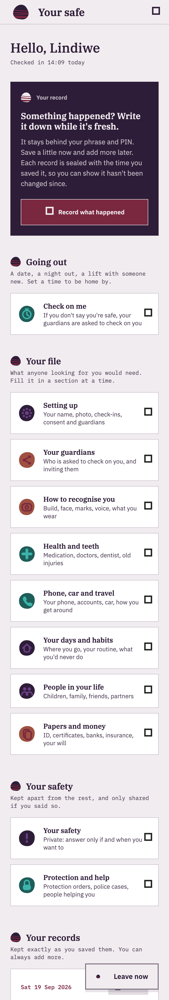

# The Sixele website

This repository holds the public site, the marketing screenshot library and the tooling that captures it. It expects the app checked out beside it at `../sixele-app` (or set `SIXELE_APP_DIR`), because the screenshots are rendered by the app's own test suite and the fonts, brand marks and icons are copied from the app.

One static page about Sixele, built from the same design system as the app.
No build step, no framework, nothing loaded from anyone else: open it with
any static server.

```sh
python3 -m http.server 8765   # then http://localhost:8765
```

| File | What it is |
| --- | --- |
| `index.html` | The page. All the words are here. |
| `styles.css` | The design system for the web: the tokens from `lib/theme/` and the rules of `openspec/specs/design-language/spec.md`. |
| `site.js` | **Leave now** only. The page works without it. |
| `sync_assets.sh` | Copies screenshots, fonts, brand marks and pebble icons in from the app. |
| `screenshots/`, `fonts/`, `brand/`, `icons/` | **Copies. Never edit these** — the next sync overwrites them. Change the source in the app and sync. |

## Updating the screenshots

The page shows files from the screenshot library by name
(`screenshots/dashboard.png` is `marketing_screenshots/latest/dashboard.png`),
so a fresh capture replaces every picture with no edit to the page:

```sh
./capture_marketing_shots.sh   # captures, archives the old set, then syncs the website
```

To sync without recapturing — after changing a font, a mark or an icon, say:

```sh
./sync_assets.sh
```

The sync also checks that every screenshot `index.html` asks for exists in the
library, and fails with the name of any that doesn't — so renaming or removing
a capture in `test/screenshots_test.dart` can't quietly leave a hole in the
page.

### Showing a different part of a screenshot

Library screenshots are full-length scrolls; the page shows one phone's worth
(390 × 844) through a window. `--shot-y` picks which part: `0%` is the top of
the screen (the default), `100%` the bottom.

```html
<div class="shot-window" style="--shot-y: 32%"></div>
```

The same file can appear twice with different values, as `report.png` and
`guardian_alert.png` do. If a recapture changes a screen's length, the five
windows that set `--shot-y` are the ones to glance at.

### Adding or swapping a screenshot

1. Add the capture to `test/screenshots_test.dart` and run
   `./capture_marketing_shots.sh` (see `marketing_screenshots/README.md`).
2. Copy a `<figure class="shot">` block in `index.html` and change the file
   name, the `alt` text (say what the screen shows — it is read aloud) and the
   caption.

## The design system on the web

`styles.css` follows the app's rules: square corners, the 6px grid, IBM Plex
with one job per family (serif titles, sans voice, mono facts), the semantic
colours in light and dark from the visitor's own setting, plum for shadows,
48 minimum for anything tappable, notices in the flow, one inverted block on
the page (**Help now**), and brand marks only ever placed directly on the page
colour, sized by the stone. If a token changes in `lib/theme/`, change it in
the `:root` block at the top of `styles.css`.

Two things differ from an app screen, on purpose: the page is two reading
columns wide (1152) rather than one, and screenshots sit in a window with a
plum offset shadow so they read as pictures of a screen rather than as part
of the page.

## Before publishing

- **Two screenshots say what the app is disguised as** (`check_on_me.png` and
  `signup_touch.png` mention a notification "that looks like a music app's").
  The page's own words don't. Decide whether a public page should; if not,
  swap those two pictures or change their `--shot-y`.
- There is no contact address on the page yet.
- The helpline numbers are the ones in `lib/data/questions.dart` (`helpLines`)
  and need the same practitioner check as the app's.
- **Leave now** goes to a weather search. It can't clear browser history; the
  notice at the top of the page says so.
